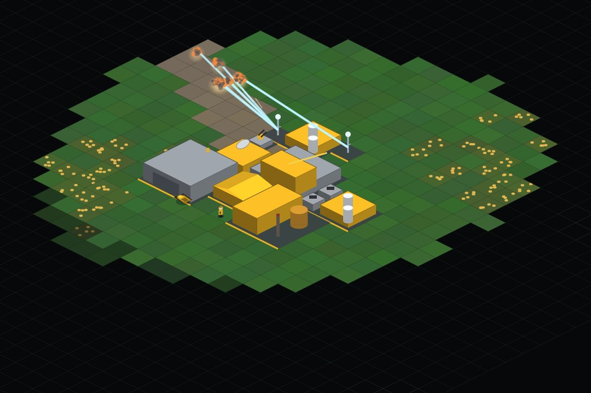
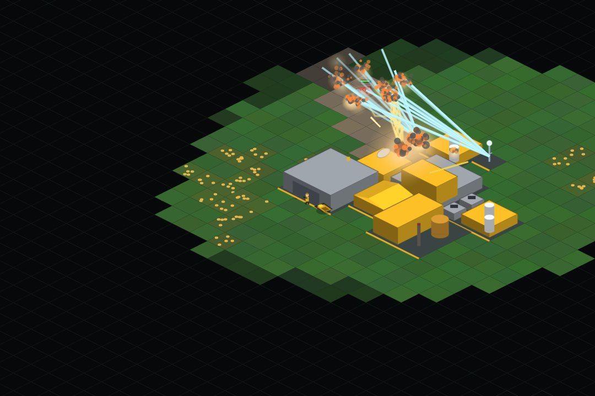
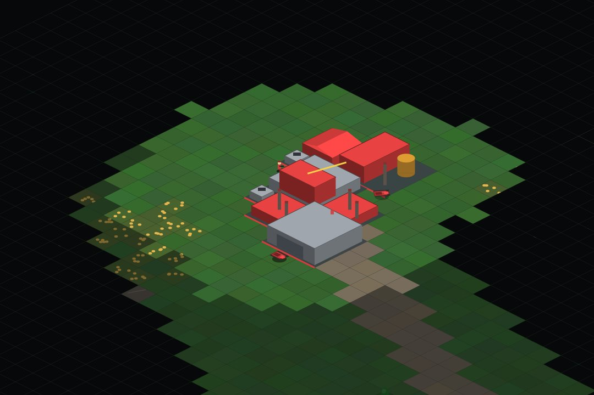
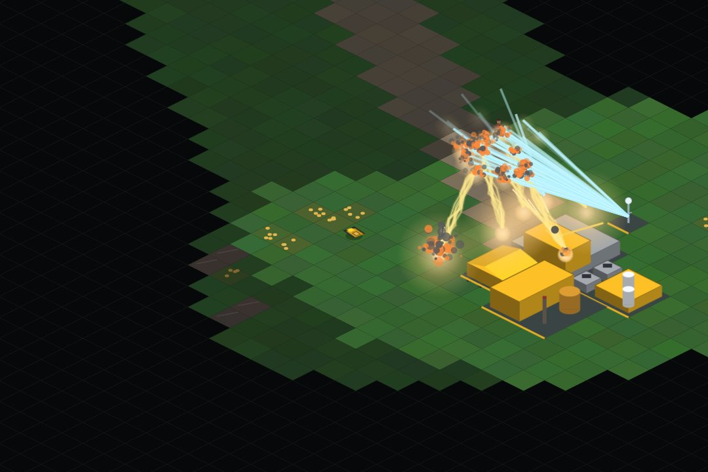

# Red Horizon RTS

**An original, fully playable isometric real-time strategy game in the spirit of the golden-age 2000s RTS classics — built from scratch in TypeScript, with zero runtime dependencies, zero binary assets, and a deterministic simulation core.**

**一款致敬 2000 年代黄金时期等距 RTS 经典的原创即时战略游戏 —— TypeScript 从零自研引擎，零运行时依赖，零二进制资产，确定性仿真内核。**


|  |  |
| :--: | :--: |
| *An Atlantic Concord base at work · 大西洋协约基地* | *Lance Towers repelling a militia wave · 光矛塔击退民兵潮* |

|  |  |
| :--: | :--: |
| *The Crimson Pact war machine · 深红同盟战争机器* | *Harvesting under fire · 炮火下的采矿作业* |

*(All shots are real gameplay rendered by the procedural engine — the repository contains no image assets.)*

---

## English

### What is this?

Red Horizon is a **complete skirmish RTS** playable in any modern browser. It
recreates the full gameplay loop that defined the classic isometric RTS era —
deploy your mobile HQ, mine ore, balance the power grid, climb a tech tree,
field an asymmetric army across land, sea and air, charge superweapons, and
erase your enemy from the map — with **100% original code, original faction
design, and procedurally generated art and sound**.

This is a fan-made homage to a genre, not a copy of any game: it contains no
assets, names, or text from any commercial title, and is not affiliated with
or endorsed by Electronic Arts. See [Legal](#legal--attribution).

### Feature checklist (no toy-scoping)

**Economy & base**
- ☑ Ore fields and high-value gem fields that visibly deplete, tile by tile
- ☑ Autonomous harvesters (seek → mine → haul → unload state machine)
- ☑ Power grid: under-supply slows production, kills radar, and shuts down defenses
- ☑ Pay-as-you-go production financing (cancel = refund what you paid)
- ☑ RA-style sidebar with **six parallel production tabs** (structures, defense, infantry, vehicles, air, navy)
- ☑ Build-radius placement rules, green/red footprint preview, construction animations
- ☑ Sell, repair, rally points, MCV deploy/redeploy
- ☑ Capturable neutral oil derricks (engineers), engineer capture of enemy buildings
- ☑ Multiple factories of the same type speed up their production tab

**Combat**
- ☑ 13 warhead types × 9 armor classes damage matrix — every unit has a role and a counter
- ☑ Projectile physics: hitscan, ballistic shells with splash, homing missiles, chain lightning, energy beams, gravity bombs
- ☑ Line-of-sight target acquisition, minimum ranges, anti-air vs. anti-ground weapon roles
- ☑ Veterancy: 3 ranks earned by kill value — damage, armor and elite self-heal bonuses
- ☑ Heavy tanks crush infantry; suicide bombers detonate on contact
- ☑ Stealth mind-games: the Phantom tank disguises itself as a tree while idle
- ☑ Deployable infantry (brace for +range/+damage), commando C4 demolition
- ☑ Fog of war: black shroud + explored-but-stale fog, per-player vision

**The map**
- ☑ Seeded procedural battlefields — 6 curated maps, every replay identical from its seed
- ☑ Terrain that matters: roads speed you up, forests slow you down, cliffs block, bridges cross rivers
- ☑ Land / sea / air movement domains with separate pathfinding

**Superweapons** (each faction gets two, with global warnings)
- ☑ Tempest Strike — a rolling ion storm
- ☑ Chrono Relay — mass-teleport your strike force
- ☑ ICBM Launch — the big one, with a launch klaxon for everyone
- ☑ Aegis Field — 8 seconds of invulnerability

**AI**
- ☑ Three difficulties; plays by the same rules through the same command API
- ☑ Deploys, expands, teches up, walls its base, scouts, masses attack waves, defends, captures oil, fires superweapons
- ☑ 1–3 AI opponents per match

**Presentation**
- ☑ Smooth-scrolling isometric renderer with interpolated 60 fps on a 20 tps sim
- ☑ Procedural sprites: 360° vehicle facings with independent turrets — no image files anywhere
- ☑ Radar minimap (goes dark without a powered radar — information is a building you can lose)
- ☑ Battlefield announcer (EVA-style) via speech synthesis + message ticker
- ☑ All SFX synthesized live with WebAudio oscillators & filtered noise
- ☑ Control groups (Ctrl+0-9), attack-move, box select, double-click type-select, rally points, edge scrolling, adjustable game speed
- ☑ Full menu flow: faction/map/difficulty/funds/superweapon setup → match → after-action report

### Quick start

```bash
git clone https://github.com/appleweiping/red-horizon-rts.git
cd red-horizon-rts
npm install
npm run dev        # → http://localhost:5199
```

```bash
npm test           # 57 unit & integration tests (Node, no browser needed)
npm run typecheck  # strict TypeScript, zero errors
npm run build      # production bundle (~40 KB gzipped JS)
```

No accounts, no servers, no assets to download. `npm install` fetches dev
tooling only (Vite / TypeScript / Vitest); the shipped game has **zero
runtime dependencies**.

### How to play

1. **Deploy.** Select your Pioneer Crawler, press `D`. It becomes your Construction Yard.
2. **Power → Ore Refinery → Barracks / War Factory.** The refinery ships with a free harvester; keep her safe.
3. **Watch the power bar.** Red means production crawls and defenses sleep.
4. **Radar unlocks tier 2** (and the minimap). The **Battle Lab unlocks tier 3** and superweapons.
5. **Counter, don't spam:** rifles shred infantry, AP hunts tanks, flak owns the sky, artillery cracks bases.
6. Kill every enemy structure and construction vehicle to win.

| Input | Action |
|---|---|
| Left drag | Box-select units |
| Right click | Move / attack / harvest / capture (context-sensitive) |
| Shift + right click | Queue waypoints |
| Double-click unit | Select all of that type on screen |
| `A` | Attack-move (engage everything on the way) |
| `S` | Stop |
| `D` | Deploy (MCV ↔ base; guardsmen brace) |
| `H` | Jump to your Construction Yard |
| `Ctrl+0-9` / `0-9` | Assign / recall control group |
| Arrow keys / screen edge | Scroll |
| `Esc` | Cancel mode / pause menu |
| Sidebar right-click | Cancel production |

### The factions

**Atlantic Concord** — *Precision. Mobility. Light itself as a weapon.*
Faster, trickier, more surgical; wins by picking its battles.

| Unit | Role |
|---|---|
| Guardsman | Rifle infantry; deploys into a braced +range stance |
| Jet Trooper | Flying infantry, hits air and ground |
| Agent Naomi | Commando: sniper pistol + C4 that levels buildings |
| Strike IFV | Fast rockets, ground **and** air |
| Wolf Tank | Cheap, quick medium tank |
| Phantom Tank | Disguises as a tree while idle; ambush tank-hunter |
| Lance Artillery | Long-range energy beam |
| Kestrel Jet | Two-missile strike sorties, rearms at the airfield |
| Corvette / Siege Cruiser | Naval patrol / 11-tile shore bombardment |
| Defenses | Gun Bunker · SAM Site · Lance Tower |
| Superweapons | **Tempest Strike** (ion storm) · **Chrono Relay** (mass teleport) |

**Crimson Pact** — *Steel floods. Sky burns. Numbers never lie.*
Slower, heavier, cheaper; wins the fight you can't avoid.

| Unit | Role |
|---|---|
| Militia | 120-credit rifleman; quantity is quality |
| Arc Trooper | Armored shock infantry, electric discharge |
| Flak Trooper | Man-portable anti-air |
| Demolisher | Runs at things. Detonates. Doesn't come back |
| Viper Drone | Fast robotic vehicle-shredder |
| Bear Tank | Heavy MBT that wins head-on trades |
| Hailstorm Launcher | 10-tile rocket artillery |
| Behemoth Tank | Twin cannons + own flak; a rolling fortress |
| Leviathan | Colossal bomber airship |
| Sea Scorpion / Dreadnought | Flak gunboat / 12-tile missile battleship |
| Defenses | Sentry Gun · Flak Cannon · Arc Tower |
| Superweapons | **ICBM Launch** (nuke) · **Aegis Field** (invulnerability) |

Shared: Engineer (capture) and the Pioneer Crawler (MCV). Tech tree:
`Power → Refinery → Barracks / War Factory / Radar(T2) → Battle Lab(T3)`.

### Engineering highlights

- **Deterministic lockstep-ready sim.** Fixed 20 tps steps, one seeded RNG,
  commands-in / events-out. The test suite replays full AI-vs-AI matches and
  asserts bit-identical state. Same seed + same commands = same war, always.
- **Sim/render separation.** `src/sim` never touches the DOM; the whole
  engine runs headless in Node, which is how 57 tests cover economy cycles,
  superweapon strikes and ten-minute AI battles without a browser.
- **Everything procedural.** Units are parametric vector drawings squashed
  onto the isometric plane (free 360° facings + turret rotation); buildings
  are prerendered isometric box stacks; audio is synthesized oscillator
  recipes; the announcer is the Web Speech API. The repository contains **no
  images and no audio files**.
- **Data-driven rules.** All balance lives in `src/data/` as typed tables —
  the engine interprets, the data decides ([modding guide](docs/MODDING.md)).
- **Background-proof loop.** A Web Worker heartbeat keeps the war going when
  the tab is hidden (RAF freezes, page timers get throttled to 1/minute —
  the worker doesn't).

Deep dive: [docs/ARCHITECTURE.md](docs/ARCHITECTURE.md) ·
[docs/GAMEPLAY.md](docs/GAMEPLAY.md) · [docs/MODDING.md](docs/MODDING.md)

### Project layout

```
src/
├── core/     types · constants · math · seeded RNG · event queue
├── data/     the "rules": weapons · armor matrix · units · buildings · superweapons
├── map/      seeded map generator · terrain model · map catalog
├── sim/      the deterministic engine: world · pathfinding (A*) · movement
│             combat · economy · production · power · fog · superweapons · victory
├── ai/       skirmish AI (same Command API as the human)
├── render/   isometric renderer · procedural sprites · effects · minimap
├── ui/       sidebar HUD · input · selection · menus · message ticker
├── audio/    WebAudio synthesizer · EVA speech
├── game.ts   fixed-step loop wiring sim ↔ presentation
└── main.ts   bootstrap
tests/        57 tests: determinism replays · pathfinding · combat math
              economy cycles · production · superweapons · victory · AI soak
```

### Roadmap

- Lockstep multiplayer (the sim is already deterministic and command-driven)
- Replay recording & playback (same foundation)
- Save/load, map editor, unit transports, naval subs, more maps & factions
- Scripted challenge scenarios

Contributions welcome — the modding guide is the best place to start.

### Legal & attribution

Red Horizon is an original work: all source code, faction/unit names, art
(procedurally generated), sound (synthesized) and text were created for this
project and are released under the [MIT License](LICENSE). It is a genre
homage inspired by the *mechanics* of classic late-90s/2000s isometric RTS
games. It contains no assets, code, names, story, or audio from any
commercial game, is not a copy of any specific title, and is not affiliated
with, sponsored by, or endorsed by Electronic Arts or any other rights
holder. All trademarks belong to their respective owners.

---

## 中文说明

### 这是什么？

Red Horizon（红色地平线）是一款**可以直接在浏览器里玩的完整遭遇战 RTS**。它完整复刻了
经典等距 RTS 时代的全部玩法循环——展开基地车、采矿、平衡电力、攀升科技树、指挥海陆空
不对称大军、给超级武器充能、把敌人从地图上抹掉——而且**代码 100% 原创、阵营设计原创、
美术与音效全部程序化生成**。

这是一封写给整个流派的情书，不是对任何游戏的拷贝：项目不包含任何商业游戏的资产、
名称或文本，与 Electronic Arts 无任何关联（详见上方 Legal 节）。

### 完整度清单（反玩具化承诺）

- **经济**：矿田/宝石田逐格枯竭、矿车全自动循环、电力不足会拖慢生产/关闭雷达与防御塔、
  边造边扣款（取消即退款）、RA 式侧边栏六个并行生产队列、建造半径校验与红绿格预览、
  出售/维修/集结点/基地车重新部署、工程师占领中立油井与敌方建筑
- **战斗**：13 种弹头 × 9 种护甲的伤害矩阵、六类弹道（即时/抛物线溅射/追踪导弹/链状电弧/
  能量射线/重力炸弹）、防空与对地武器严格分工、三级老兵系统、重型载具碾压步兵、
  自爆兵、幻影坦克待机拟树、驻扎步兵、特工 C4 爆破、双层战争迷雾
- **地图**：种子化程序生成的 6 张精选战场，道路加速、森林减速、悬崖阻挡、桥梁渡河，
  海陆空三套寻路域
- **超级武器**：雷暴打击 / 超时空传送 / 洲际导弹 / 神盾力场，各阵营两件，全场警报播报
- **AI**：三档难度，与人类走同一套命令 API——展开、扩张、爬科技、修防御、侦察、
  攒波进攻、回防、抢油井、放超武，支持 1–3 个 AI 对手
- **表现**：20tps 仿真 + 插值 60fps 渲染、程序化精灵（车体 360° 朝向+独立炮塔）、
  雷达小地图（没雷达就黑屏——情报是一栋会被打掉的建筑）、EVA 式语音播报、
  WebAudio 全合成音效、编队/攻击移动/框选/双击同类/变速

### 快速开始

```bash
git clone https://github.com/appleweiping/red-horizon-rts.git
cd red-horizon-rts
npm install
npm run dev        # 打开 http://localhost:5199
```

`npm test` 跑 57 个单元/集成测试；`npm run build` 产出约 40KB (gzip) 的生产包。
运行时**零依赖**，仓库里**没有任何图片或音频文件**。

### 上手指南

1. 选中基地车按 `D` 展开成建造场；
2. 电厂 → 矿场（自带矿车）→ 兵营/战车工厂；
3. 盯住电力条，红了就补电厂；雷达解锁 T2 和小地图，作战实验室解锁 T3 和超武；
4. 讲究克制而不是爆一种兵：步枪打步兵、穿甲打坦克、高射管天空、火炮拆基地；
5. 摧毁敌方全部建筑与基地车即获胜。

快捷键：左键框选 · 右键情境指令（移动/攻击/采矿/占领）· Shift 排队路径点 ·
`A` 攻击移动 · `S` 停止 · `D` 部署 · `H` 回基地 · `Ctrl+0-9` 编队 · `Esc` 菜单。

### 工程亮点

- **确定性仿真内核**：固定步长、单一种子 RNG、命令进/事件出——同种子同指令流必然
  重演出同一场战争（测试套件对整场 AI 内战做逐位一致断言），这是 lockstep 联机的地基；
- **仿真/渲染严格分离**：`src/sim` 不碰 DOM，整个引擎可在 Node 里无头运行，
  57 个测试因此能覆盖采矿闭环、超武打击和十分钟 AI 大战；
- **全程序化资产**：矢量参数化单位 + 等距盒体预渲染建筑 + 振荡器合成音效 + Web Speech 播报；
- **数据驱动规则**：所有平衡数值集中在 `src/data/`（改数据即改平衡，见 [MODDING](docs/MODDING.md)）；
- **后台不断线**：Web Worker 心跳绕过浏览器对隐藏页的定时器节流，切走标签页战争照打。

### 法律声明

本项目为原创作品：全部源码、阵营与单位命名、程序化美术、合成音效与文案均为本项目
创作，以 MIT 协议开源。它是对 90 年代末–2000 年代经典等距 RTS **玩法机制**的致敬，
不包含任何商业游戏的资产/代码/名称/剧情/音频，不是对任何特定作品的复制，
与 Electronic Arts 及任何其他权利方无关联、无赞助、无背书。
