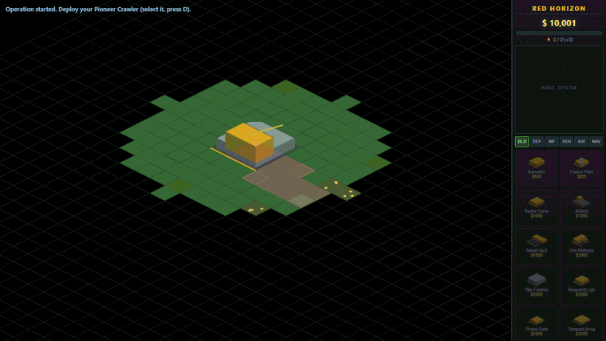
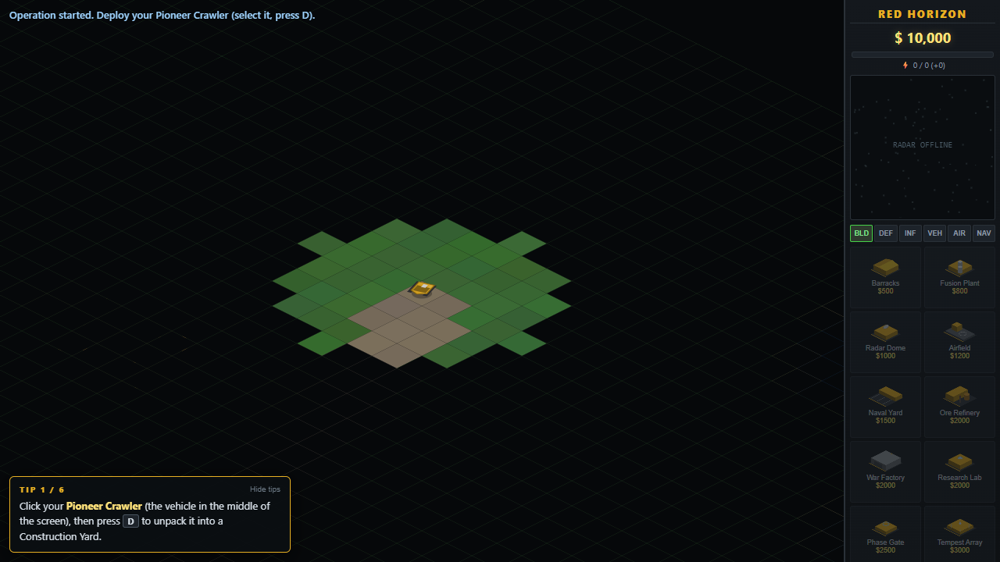

# Red Horizon

A single-player real-time strategy game for the browser: build a base, mine ore and fight one to three computer opponents on isometric maps.

**Play it: <https://appleweiping.github.io/red-horizon-rts/>** (desktop browser, mouse and keyboard)



I wrote it from scratch in TypeScript to learn how classic RTS games work
underneath: a fixed-tick simulation, grid pathfinding, an ore economy, a
power grid and a computer opponent that has to play by the same rules as the
player. The two factions, all unit names and all art are my own; sprites are
drawn in code and sound effects are synthesized, so the game ships no image
or audio files.

## Quick start

```bash
git clone https://github.com/appleweiping/red-horizon-rts.git
cd red-horizon-rts
npm install
npm run dev      # http://localhost:5199
```

```bash
npm test         # 57 Vitest tests; the engine runs in Node, no browser needed
npm run build    # type-check + static site in dist/ (about 42 KB of gzipped JS)
```

## How to play

1. Click your **Pioneer Crawler** and press `D`. It unpacks into a Construction Yard.
2. Build a power plant, then an **Ore Refinery**. The refinery comes with a harvester that mines on its own.
3. Add a **Barracks** or **War Factory** and train units. If the power bar turns red, production slows and defenses switch off, so build another plant.
4. A **Radar Dome** turns on the minimap and unlocks tier-2 units; the **Research Lab** unlocks tier 3 and the superweapons.
5. Destroy every enemy structure and Pioneer Crawler to win.

The first match shows a small tips panel that follows these steps and moves on
as you complete them. You can hide it, and the main menu has a TIPS on/off switch.



## Controls

| Input | Action |
|---|---|
| Left click / left drag | Select a unit / box-select |
| Double-click a unit | Select all of that type on screen |
| Right click | Move, attack, harvest or capture, depending on the target |
| Shift + right click | Queue waypoints |
| `A`, then click | Attack-move |
| `S` | Stop |
| `D` | Deploy (Crawler into a base; Guardsmen brace for extra range) |
| `H` | Jump to your Construction Yard |
| `Ctrl` + `0`–`9`, then `0`–`9` | Assign / recall a control group (double-tap to jump to it) |
| Arrow keys or screen edge | Scroll |
| Sidebar click / right click | Start / cancel production |
| `Esc` | Cancel the current mode, or open the pause menu |

There are no touch controls; on a phone the game will load but you cannot really play it.

## The two factions

| | Atlantic Concord | Crimson Pact |
|---|---|---|
| Style | Faster, lighter, more precise | Slower, heavier, cheaper per unit |
| Signature units | Thicket Tank (hides as a tree while idle), Agent Naomi (commando with C4), Lance Artillery (beam) | Demolisher (suicide bomber), Behemoth Tank, Leviathan (bomber airship) |
| Superweapons | Tempest Strike (storm), Phase Gate (teleport a group) | ICBM Launch, Aegis Field (8 s of invulnerability) |

Full unit list, damage table and tech tree: [docs/GAMEPLAY.md](docs/GAMEPLAY.md).


## How it's built

- **Fixed-step simulation.** `src/sim/` advances the world in 50 ms ticks with a single seeded RNG. Player and AI input enter only as commands through `World.issue()`. `tests/determinism.test.ts` runs the same seed and command stream twice, including whole AI-vs-AI matches, and checks that the resulting states match.
- **Headless engine.** Nothing under `src/sim`, `src/ai`, `src/map` or `src/data` touches the DOM, which is why the tests can play ten minutes of an AI match in Node (`tests/ai.test.ts`).
- **Pathfinding.** A* on the tile grid with separate passability rules for land and naval units; aircraft fly straight (`src/sim/pathfinder.ts`, tested in `tests/pathfinder.test.ts`).
- **Data-driven rules.** Weapons, the warhead-by-armor damage matrix, units, buildings and superweapons are typed tables in `src/data/`. [docs/MODDING.md](docs/MODDING.md) walks through adding a unit.
- **Art and sound in code.** Units are vector drawings projected onto the isometric plane at any facing (`src/render/sprites.ts`), buildings are shaded box stacks, effects are WebAudio oscillators and filtered noise (`src/audio/audio.ts`), and the announcer uses the browser's speech synthesis.
- **Same rules for the AI.** The skirmish AI in `src/ai/ai.ts` builds, expands and attacks only through the same commands the mouse and keyboard produce.

More detail: [docs/ARCHITECTURE.md](docs/ARCHITECTURE.md).

## Why not OpenRA?

If you want to play the original Command & Conquer and Red Alert games,
[OpenRA](https://www.openra.net/) is the mature open-source engine for that,
with multiplayer and the real campaigns. Red Horizon is much smaller: a
skirmish-only game with its own factions that runs from a static web page with
nothing to install. Its main value is as a readable codebase.

## Limitations

- Single player only. The command-driven simulation is the groundwork for lockstep multiplayer and replays, but neither exists yet.
- No save/load, no campaign, no map editor.
- The AI is hand-written rules (build order, expansion, attack waves), not a learned policy, so it gets predictable after a few games.

## Project layout

```
src/core    types, constants, seeded RNG, event queue
src/data    weapons, armor matrix, units, buildings, superweapons, factions
src/map     seeded map generator and the map list
src/sim     world, movement, combat, economy, production, power, fog, victory
src/ai      skirmish AI
src/render  isometric renderer, sprites, effects, minimap
src/ui      sidebar, input, selection, menus, tips panel
src/audio   WebAudio sound effects and the announcer
tests/      Vitest suites for all of the above that run without a browser
```

## 中文简介

Red Horizon（红色地平线）是一个浏览器里的单机即时战略游戏：展开基地车、采矿、管理电力、
造兵，和 1–3 个电脑对手打遭遇战。TypeScript 从零写成，仿真内核与渲染完全分离，可以在
Node 里无头运行测试；单位和建筑都由代码绘制，音效由 WebAudio 合成。在线试玩：
<https://appleweiping.github.io/red-horizon-rts/>（需要鼠标和键盘）。

## License and credits

MIT, see [LICENSE](LICENSE). The gameplay is inspired by the isometric RTS
games of the early 2000s, Red Alert 2 in particular. This project uses none of
their code, art, sound or names and is not affiliated with Electronic Arts.
